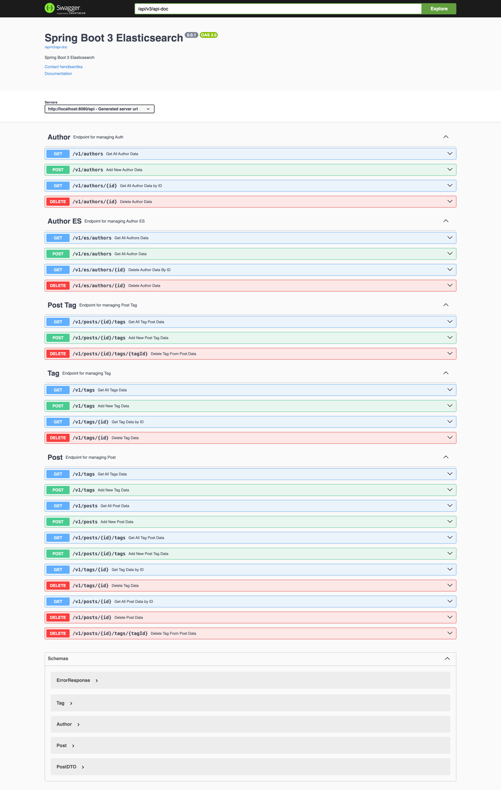

# spring-boot-elasticsearch

[](https://github.com/hendisantika/spring-boot-elasticsearch/actions/workflows/maven.yml)


Sample REST API with **Spring Boot 4** that stores blog data (authors, posts, tags) in an H2 database via
Spring Data JPA and indexes/searches it in **Elasticsearch 9** via Spring Data Elasticsearch and the
Elasticsearch Java client.

## Tech Stack

| Component              | Version / Notes                                         |
|------------------------|---------------------------------------------------------|
| Java                   | 25 (Temurin recommended)                                |
| Spring Boot            | 4.1.x (Web MVC, Data JPA, Data Elasticsearch, Actuator) |
| Elasticsearch client   | `co.elastic.clients:elasticsearch-java` 9.x (`Rest5Client`) |
| Database               | H2 (in-memory)                                          |
| API docs               | springdoc-openapi (Swagger UI)                          |
| Build                  | Maven (wrapper included)                                |
| Tests                  | JUnit 6, AssertJ, Testcontainers 2 (Elasticsearch 9.5.6) |

## Prerequisites

- **JDK 25**
- **Docker** — required for running the tests (Testcontainers) and for the local Elasticsearch via `compose.yaml`

## Getting Started

1. Clone this repository: `git clone https://github.com/hendisantika/spring-boot-elasticsearch.git`
2. Navigate to the folder: `cd spring-boot-elasticsearch`
3. Make sure your ELK stack is UP & RUNNING (Spring Boot Docker Compose support starts `compose.yaml`
   automatically when Docker is running), and check the `spring.elasticsearch.*` settings in
   `src/main/resources/application.yml`
4. Run the application: `./mvnw clean spring-boot:run`
5. Open your favorite browser: http://localhost:8080/api/swagger-ui

## Running Tests

```shell
./mvnw clean verify
```

Tests spin up a real Elasticsearch container with Testcontainers, so Docker must be running.

| Test class                                | What it covers                                              |
|-------------------------------------------|-------------------------------------------------------------|
| `ProductTests`                            | JSON (snake_case) mapping of the `Product` DTO              |
| `ElasticSearchTests`                      | Indexing, get by id & aggregations via `Rest5Client` over TLS |
| `SpringBootElasticsearchApplicationTests` | Full context load with a `@ServiceConnection` Elasticsearch |

## Configuration

| Property                           | Default                 | Description                         |
|------------------------------------|-------------------------|-------------------------------------|
| `spring.elasticsearch.uris`        | `http://localhost:9200` | Elasticsearch endpoint              |
| `spring.elasticsearch.username`    | `elastic`               | Elasticsearch user                  |
| `spring.elasticsearch.password`    | see `application.yml`   | Elasticsearch password              |
| `app.elasticsearch.product-index`  | `products`              | Index used by `ProductService`      |

## CI/CD & Dependency Updates

- **GitHub Actions** (`.github/workflows/maven.yml`): builds and tests on every push/PR to `main` with
  JDK 25, uploads surefire reports on failure and submits the dependency graph on `main`.
- **Dependabot** (`.github/dependabot.yml`): daily Maven & GitHub Actions updates and weekly
  docker-compose image updates, grouped (Spring Boot, Elasticsearch, Testcontainers, springdoc,
  Jackson, minor/patch) to keep PR noise low.

## Image Screenshot

Swagger UI


